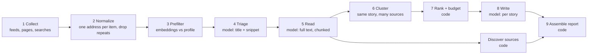

# Topic radar — design brainstorm

**Status: brainstorm.** Nothing is built yet. The shape: one process on a laptop, a local Ollama model, a fresh prompt for every model call, structured answers checked by code, and code (not the model) deciding when to stop.

## 1. The problem

Every week I check a set of sites and searches to keep up with technical fields: software design, AI research, materials science, regulation in my area (FDA, Federal Register), and so on. The chore is the same each week: open each source, find what's new since last time, decide whether it matters, and decide what's worth actually reading.

Topic radar does that chore on my laptop and gives me one short report.

**Who runs it:** someone who follows a technical field, not necessarily a developer. They can open a folder, read a text file, and type a command they were given, but shouldn't need to know Python, databases or a terminal beyond that. Every design choice below is checked against that person.

## 2. Goals

| # | Goal | How we'll know |
|---|---|---|
| G1 | A weekly report I can read in **under 5 minutes** | Report body is about 900–1,200 words; at most 7 top stories; everything else is a one-liner or a count |
| G2 | The report tells me **what's new** and **what's worth more of my time** | Every story has a "Read if…" line and direct links to the source text |
| G3 | **Only new things**: nothing I saw last week shows up again unless it changed in a way that matters | A cursor per source; a history of items already seen; a check for "this changed" vs "this is a repeat" |
| G4 | **Runs on a laptop with macOS or Windows**, with a local model (`gemma4:e4b`-class); the target is a laptop with **16 GB of RAM** | A full weekly run finishes in about 30–60 minutes unattended on a 16 GB Apple silicon Mac; the tool itself stays under about 8 GB at its peak, leaving the rest for the system and whatever else is open; the same code and the same files on both systems (8.0, 8.6) |
| G5 | **Started by hand or on a schedule**, with no human input mid-run | A **Run now** button, one command, or a scheduled job (launchd on Mac, Task Scheduler on Windows); a failed source doesn't fail the run |
| G6 | **General**: any topic, not just the ones above | Topics, sources and preferences are data, never code |
| G7 | **Improves from light feedback**, without me maintaining config | One line of feedback ("more like S2, less vendor marketing") changes next week's report; the learned preferences are written down where I can see them |
| G8 | **Trustworthy**: no invented facts or links | Every link comes from code, never typed by the model; every claim in a story carries a quote that appears word for word in its source |
| G9 | **I can see what it did** without developer tools | Everything is plain files in folders: Markdown to read, CSV to open in Excel or Numbers, YAML to glance at. No database. Finder, Spotlight, File Explorer or any text search finds a site or an article in any run |
| G10 | **Nothing to sign up for** | No accounts, API keys or tokens; no services to install besides Ollama. The web is read through a local browser (Playwright) and plain HTTP |

## 3. Non-goals

- Not a general search engine or a news reader. It reads a bounded set of sources plus a few searches per week.
- No hosted LLM APIs and no paid or keyed services of any kind.
- No logins, no paywall workarounds. A paywalled item is reported by title and link only.
- No real-time alerts. Weekly (or whatever interval I pick) is the rhythm.
- Not a multi-user service. One person, one laptop.

## 4. What I give it

Three things, all short and in plain language. The design rule is: **I describe what I want once; the tool keeps the details.**

### 4.1 A watch file

One file per area I follow (a "watch"). It's the only file I write, and I rarely touch it after the first week. I don't even have to write it from scratch: `topic-radar new` asks a few questions in plain words ("What do you want to keep up with?", "What should I ignore?", "Any sites you already check?") and writes the file for me.

```yaml
# watches/fda-devices.yaml
name: FDA and device regulation          # shown as the report section title
interests: |                             # free text, read by the model; no keyword lists needed
  FDA guidance and rules on software as a medical device, AI/ML-enabled devices,
  cybersecurity requirements for devices, 510(k) process changes.
  Comment periods and effective dates matter more than commentary about them.
not_interested: |                        # free text as well
  Drug approvals, food safety recalls, warning letters to individual manufacturers,
  law-firm marketing posts that restate a rule without adding anything.
seeds:                                   # starting places; the tool proposes more (see 4.2)
  - https://www.fda.gov/medical-devices/digital-health-center-excellence
  - https://www.federalregister.gov/agencies/food-and-drug-administration
searches:                                # web searches run each week through the local browser
  - "FDA AI-enabled device guidance"
interval: 7d                             # how far back "new" reaches on the first run, and the expected run rhythm
```

```yaml
# watches/ai-research.yaml
name: AI breakthroughs
interests: |
  New model architectures, small models that run locally, agent frameworks,
  evaluation methods, inference efficiency on Apple silicon.
  I care about results with numbers, not announcements.
not_interested: |
  Funding rounds, executive moves, opinion threads, AI art.
seeds:
  - https://arxiv.org/list/cs.CL/new
  - https://ollama.com/blog
  - https://github.com/ollama/ollama/releases
  - https://news.ycombinator.com/best
```

Seeds are just web addresses. The tool works out what each one is (section 5).

### 4.2 Confirming sources

The tool keeps its list of sources per watch in `sources/<watch>.yaml`, a readable file (section 8.4). Each source has a status, and **nothing becomes a regular source without my confirmation**:

| Status | Meaning |
|---|---|
| `proposed` | Found by the tool (from my seeds, from links that keep coming up, from searches). Read once as a sample, not used in the report |
| `active` | Confirmed by me. Read every run |
| `muted` | I said no, or "less of this source". Not read; not proposed again |
| `broken` | Failed three runs in a row (not found, blocked, layout changed). Listed in Run health until fixed or muted |

The first run (`topic-radar init <watch>`) turns my seeds into concrete sources: it finds a site's RSS/Atom feed or sitemap, or notices that a page is a list of posts. It shows me the list and I confirm each one with a keystroke (`y` yes / `n` no / `s` sample first). After that, new candidates appear at the bottom of each report ("Candidate sources") and I accept them with a line of feedback.

### 4.3 Feedback

Covered in section 9. The short version: I write one line, in words, and the tool turns it into changes it shows me back.

## 5. Knowing what's new: cursors

The tool must know, per source, what it already saw. Different sources give different handles, so each kind of source has its own reader with its own cursor. Readers try the cheapest, most reliable method first; the model is only used when a page has no structure to lean on.

Everything here is **plain web access**: public pages, public feeds, and public read-only endpoints that need no account or key. Nothing is installed besides the tool, Ollama and Playwright's Chromium.

| Kind of source | Cursor | Notes |
|---|---|---|
| RSS / Atom feed | item ids + the newest published date seen | The best case. Most blogs, many agencies, arXiv listings, GitHub releases (`/releases.atom`) and Federal Register searches all offer one |
| Sitemap (`sitemap.xml`) | the last-modified date per address | Good for sites without feeds; limited to the paths that match the source (`/news/`, `/guidance/`) |
| Listing page (a "News" or "Guidance documents" page with no feed) | the addresses of items already seen | Read with Playwright as a page outline (7.1); items are pulled out by code (repeated link patterns), with a model fallback that names items by link number |
| Single living document (a guidance page, a changelog, a "what's new" page) | a fingerprint per section (split at headings, 7.1) | A changed section is the "new item"; the report says what changed, with the old and new text |
| Web search | the addresses of results already seen | Run in the local Chromium through Playwright, on a public search engine's results page with its "past week" filter; read with the page outline. No API, no key (section 7, step 1) |

Rules every reader follows:

- **Conditional requests**: send `If-None-Match` / `If-Modified-Since` so an unchanged source costs almost nothing.
- **One address per item**: strip tracking parameters (`utm_*` and the like), follow redirects, keep the final address. That's how repeats are recognized.
- **A cursor only moves forward after a successful run.** A source that fails keeps its old cursor, so next week catches up instead of skipping.
- **First run** reads back one `interval` only, so the first report isn't buried in history.
- **"Changed" vs "repeat"**: an item seen before whose content changed (a proposed rule became final, a paper got a v2) comes back as an update, labelled as such. Otherwise it's never shown twice.
- **Polite fetching**: robots.txt respected, one request at a time per site, a small delay between requests, a user agent naming the tool.

Where cursors and history live is in section 8.4: in the sources file and a history spreadsheet, both readable.

## 6. The report

Markdown, plus an HTML version of the same content. Written into the run folder and copied to `reports/latest.md` and `reports/latest.html`. A desktop notification (Mac or Windows) opens it when the run finishes.

### 6.1 One report for all watches

One combined report each run, not one per watch. The 5-minute budget is for my week, not per topic, and a combined top list forces the tool to rank across topics. To keep one busy watch from crowding out the others, each watch gets at most 3 of the 7 top stories, and each watch always has its own Quick hits group, even if it has no top story that week.

### 6.2 Shape

| Section | What's in it | Budget |
|---|---|---|
| **This week in 30 seconds** | 3–5 bullets across all watches | ~80 words |
| **Top stories** | At most 7. Each: headline, what happened (2–3 sentences), why it matters to me, **Read if…**, links, how many sources covered it, a short id (`S1`…) for feedback | ~100 words each |
| **Dates to know** | Comment deadlines, effective dates, conferences, release dates, pulled from the items. Sorted by date | one line each |
| **Quick hits** | Relevant but minor: one line + link each, grouped by watch, at most ~15 | one line each |
| **Trends** | Themes rising or falling against the last 4–8 runs ("three groups published 2-bit quantization results this week; none last month") | ~80 words |
| **Filtered out** | Counts per reason ("41 items: drug approvals; 12: funding news"), with a link to the run's `items.csv` to see them all | counts only |
| **Candidate sources** | New sources the tool wants to add, with why and a sample item | one line each |
| **What I think you want** | The learned preferences in plain sentences (section 9.3), so I can correct them | ~100 words |
| **Run health** | Sources failed or broken, items looked at and read, run time, a link to `notes.md` | a few lines |

The first three sections are the 5-minute read. Everything below is for when I want it.

### 6.3 Example story

```markdown
### S2 · FDA opens comment on draft guidance for AI-enabled device change control plans
**What happened:** FDA published draft guidance on predetermined change control
plans for AI-enabled devices (Federal Register, Nov 4). It narrows which model
updates can ship without a new submission and adds a monitoring requirement.
**Why it matters to you:** directly in your "AI/ML-enabled devices" interest;
it changes what counts as a reportable model update.
**Read if:** you ship or plan model updates to a device in the next year.
Section V ("Modification protocol") is the part that changed from the 2023 draft.
**Comment deadline:** 2027-01-05
**Sources:** [Federal Register](…) · [FDA guidance page](…) · 2 commentaries (filtered as restatements)
**Evidence:** "a description of the methods that will be used to develop, validate,
and implement modifications" — Federal Register, §II
**What I read:** [articles/federalregister-2026-24411.md](…)
```

### 6.4 "Read if…" is the key line

The point of the report is to tell me where to spend time. Every top story ends with a concrete condition and, where the model found one, **which part** of the source to read (a section, a table, a figure). That pointer comes from the read step (section 7, step 5), which keeps the heading each finding came from.

## 7. The pipeline

One run = a fixed sequence of steps in one process, run to the end with no human input, writing its own run folder as it goes. Steps that don't need judgment are plain code. The model is used for four things only: **triage**, **reading**, **merging stories**, **writing**.



| # | Step | Model? | What it does |
|---|---|---|---|
| 1 | Collect | no | Each active source's reader fetches items since its cursor. Feeds and sitemaps over plain HTTP; listing pages, JavaScript-heavy sites and web searches through Playwright (wait for the network to go quiet, scroll to load lazy content, then read the page outline). Searches are paced slowly (a few per watch per run, seconds apart); if the search engine shows a challenge page or blocks, the search is skipped, `notes.md` says so, and the run continues |
| 2 | Normalize | no | Address, title, date, snippet, source. Drop items in the history (section 8.4). Group exact and near duplicates (same address; very similar titles) |
| 3 | Prefilter | embeddings | Embed title + snippet with a small local embedding model in Ollama (`embeddinggemma` or `nomic-embed-text`). Score against the watch's interests, not-interests, and the liked and disliked examples from feedback. Drop only the clearly irrelevant: this step cuts hundreds of items to tens, and errs on keeping |
| 4 | Triage | yes, short | One small model call per batch of ~10 titles: relevance 0–3, the interest it matches or the reason it's out, item kind (paper, release, rule, proposed rule, guidance, news, opinion, marketing). Structured answer, checked by Pydantic |
| 5 | Read | yes, chunked | For items scoring 2–3 (capped, e.g. 40 per run): fetch the full text (the article text for posts; the PDF text for papers and rules; the page outline for everything else), read it in chunks split at headings, using zoom reading for long documents (a table-of-contents call first, then only the sections that matter). Each chunk answers: what's new, numbers, dates and deadlines, the section it's in, and a **verbatim quote** for each claim. Code keeps a claim only if its quote appears word for word in the text (7.1). Each article read is saved as its own Markdown file (section 8.2) |
| 6 | Cluster | embeddings + yes | Group findings that are the same story from different sources (a paper, its blog post, three news write-ups). Embedding similarity proposes groups; a short model call confirms a merge when it's unclear. The primary source (the paper, the rule, the release notes) is marked as such; commentary that adds nothing is folded in as "covered by N others" |
| 7 | Rank + budget | no | Score = relevance × novelty (new vs update) × weight from feedback × coverage (more independent sources = higher), with a bonus for deadlines in the next 60 days. Code picks the top 7 (at most 3 per watch) and the quick hits to fit the word budget |
| 8 | Write | yes | One call per top story, with **only** that story's checked findings and quotes as input (never the raw pages, never other stories). Then one call for the 30-second summary and one for trends, each from the story summaries only. Links are inserted by code from the findings, never typed by the model |
| 9 | Assemble | no | Report from a template; finish `notes.md` and `items.csv`; then, only now, update the sources file (cursors) and the history |

Source discovery runs alongside: sites that relevant items keep linking to, and that aren't sources yet, are counted across runs; once one passes a threshold (say, linked from 3 relevant items over 2 runs), its feed or listing page is found and it's added as `proposed`.

### 7.1 Rules for working with a small local model

- **No build-up of context**: every model call gets a prompt built fresh from distilled state, never earlier messages. Essential with a 4B-class model and an 8K–16K context.
- **Structured answers with Pydantic**, parsed leniently (a link number given as text, an empty placeholder value), and a recorded error rather than a crash when an answer won't parse.
- **A page outline**, not raw HTML: headings, list items, table cells labelled by their column, and numbered links kept on the line they belong to. Read in **chunks split at headings**, with `Under: <heading path>` at the top of a continued chunk.
- **Zoom reading** for long documents: one call sees only a table of contents with section sizes and picks the sections worth reading; the rest is read only if those give nothing.
- **Verbatim quote check** before any model-reported detail is kept.
- **Links named by number**, mapped to addresses by code; a number not shown to the model is dropped.
- **Code owns the loop**: the steps run in a fixed order with fixed caps; the model never decides when to stop.
- **Everything recorded**: every prompt and raw answer is saved in the run folder (`details/`), and a command rebuilds the report from a run folder. This is what makes tuning prompts possible.
- **A scripted stand-in model** for offline tests (it returns canned answers per prompt); tests that call the real model are marked separately.
- **Fan-out with a limit**: many short reads, one model call at a time (one model loaded) and a few fetches in parallel.

## 8. Running on a Mac or Windows laptop

### 8.0 What it's built with

Everything is chosen so that the same code runs on macOS and Windows with no per-platform branches beyond a few small, named seams (8.6).

| Piece | Choice | Why |
|---|---|---|
| Language | Python 3.12 | Every library below supports macOS and Windows |
| Installing Python and packages | `uv` | One small program that installs the right Python itself and the tool's packages into its own folder. No system Python, no `pip` knowledge, identical on both systems |
| The pipeline | Plain Python (`asyncio`) | The steps run in a fixed order with fixed caps (section 7), so no agent or workflow framework is needed; one less thing to install and learn |
| Local models | Ollama | One installer per system, same commands and same HTTP interface on both |
| Browser | Playwright, driving the **Chrome or Edge already installed**, falling back to Playwright's own Chromium | Every Windows machine has Edge, most Macs have Chrome, so usually nothing extra downloads |
| Plain web requests | `httpx` | Feeds, sitemaps, conditional requests |
| Feeds | `feedparser` | RSS and Atom in all their variants |
| Article text | `trafilatura` | Pulls the article out of a page (no menus, no ads) |
| PDF text | `pypdf` | Papers and Federal Register documents; pure Python, so nothing to compile |
| Answers checked | `pydantic` | Every model answer is parsed into a typed structure or recorded as an error |
| Files | `ruamel.yaml` (keeps the comments in YAML files the tool rewrites), the standard `csv` module, `markdown-it-py` + `jinja2` for the HTML report | Readable files, written the same on both systems |
| Similar titles | `rapidfuzz` | Near-duplicate titles without a model |
| Command line | `typer` | `topic-radar run`, `find`, `feedback`, … with built-in help |
| The console (8.3) | `starlette` + `uvicorn`, plain HTML pages | A small local web page served on 127.0.0.1 |
| Laptop chores | `wakepy` (keep awake), `psutil` (battery), `desktop-notifier` (the "report is ready" notification) | Each one works on both systems behind one call |

Not chosen, on purpose: a packaged desktop app (PyInstaller, Briefcase). It would need code signing on macOS (an Apple developer account) and on Windows (SmartScreen warnings otherwise), and Playwright and Ollama don't bundle cleanly. A packaged app can come later if the scripts below turn out to be too much for someone; the code wouldn't change.

### 8.1 Models

| Role | Mac (Apple silicon) | Windows | Notes |
|---|---|---|---|
| Triage, read, merge | `gemma4:e4b-mlx` | `gemma4:e4b` (the standard build; MLX builds are Apple-only) | The strongest small model tried for reading pages, 4-bit. Context set to 8K on 16 GB machines (prompts are built fresh and chunks are ~3,000 characters, so 8K is enough); 16K on 24 GB+ |
| Write | same model | same model | On machines with 24 GB+ only, an optional larger model just for the 8–10 writing calls (a 12B-class model in 4-bit is ~8 GB), loaded once `e4b` is unloaded. Never on 16 GB |
| Embeddings | `embeddinggemma` or `nomic-embed-text` | same | Small (under 1 GB); a few hundred items embed in seconds |

The tool picks the build for the machine it's on (`model: auto`); a watch or the settings file can name a model to override it.

**Staying inside 16 GB.** The heavy pieces are never in memory together:

| Phase | In memory | Rough peak |
|---|---|---|
| Collect | the browser (one tab at a time, closed when collect finishes); the model only for the occasional listing page with no structure | ~2 GB, ~6 GB with the model |
| Prefilter | the embedding model; browser closed | ~1 GB |
| Triage, read, cluster, write | the `e4b` model with an 8K context; full text is fetched over plain HTTP, the browser reopened only for a page that needs it | ~6 GB |

One model is loaded at a time, and each is unloaded as soon as its steps finish (`keep_alive: 0` on its last call). Pages and articles are written to the run folder as they're processed, never held all at once. If the system reports memory pressure, the run waits between calls and notes it in `notes.md` rather than pushing on.

**What machine it needs:**

| Machine | Expect |
|---|---|
| Mac with Apple silicon, 16 GB (the target) | The time budget below |
| Mac with Apple silicon, 24 GB+ | A little faster; can use 16K context and a larger writing model |
| Windows with an NVIDIA GPU (6 GB+ of video memory) and 16 GB RAM | About the same as the target |
| Windows without a suitable GPU, 16 GB RAM | Runs on the processor, several times slower. The read cap shrinks automatically to keep a run near its time target (below), so fewer articles are read in full and more items become quick hits |
| 8 GB RAM | Best effort only: the installer warns and uses the smaller `gemma4:e2b` |

The installer runs a short timing test and writes the read cap it measured, so the first run is already sized for the machine.

**Time budget for a weekly run on a 16 GB Apple silicon Mac** (rough):

| Step | Count | Time each | Total |
|---|---|---|---|
| Collect | ~30 sources, ~4 searches | 1–10 s | ~4 min |
| Prefilter | ~400 items | — | under 1 min |
| Triage | ~80 items, in batches of 10 | ~15 s per batch | ~2 min |
| Read | ~30 items × ~4 chunks | ~20 s per chunk | ~40 min |
| Cluster, write, summary | ~15 calls | ~30 s | ~8 min |
| **Total** | | | **~55 min** |

The read cap (items read in full per run) is the main dial; each run sets it from the last run's measured times so a run stays under its target (60 minutes by default).

### 8.2 The run folder: what it did, in plain files

Each run writes one folder, `runs/2026-11-09-0700/`, named by date and time so they sort in order in Finder or File Explorer:

| File | For | What's in it |
|---|---|---|
| `report.md`, `report.html` | everyone | The report |
| `notes.md` | everyone | What the tool did, in plain sentences, in order (example below) |
| `items.csv` | everyone | Every item it looked at this run, one row each: watch, source, title, address, date, what it decided (`top story`, `quick hit`, `filtered`, `repeat`, `failed`), why, score. Opens in Excel or Numbers; sort or filter by any column |
| `sources.csv` | everyone | Every source it visited: status, new items found, how long it took, any error |
| `articles/` | everyone | One Markdown file per article it read in full: title, address, date, the findings with their quotes, then the text it read. Lets me check a story against what was actually on the page, and makes every article searchable later |
| `details/` | whoever tunes it | `events.jsonl`, every prompt and model answer, the saved pages |

`notes.md`, roughly:

```markdown
# Run of 2026-11-09, started 07:00, finished 07:52

07:00 Started. 3 watches, 31 active sources, 4 searches.
07:02 Federal Register (FDA): 14 new documents since 2026-11-02.
07:03 FDA Digital Health Center page: no change since last week.
07:05 Example lab blog: could not load (timed out). Nothing skipped: next run reads from 2026-11-02 again.
07:08 Search "FDA AI-enabled device guidance": 10 results, 3 not seen before.
07:10 Looked at 418 new items. Kept 62 after the first filter (see items.csv, column "decision").
07:12 Triage: 31 relevant, 19 maybe, 12 out ("drug approval" 7, "funding news" 5).
07:48 Read 28 articles (saved in articles/). Dropped 3 claims whose quotes were not on the page.
07:50 Grouped them into 17 stories. Picked 7 top stories and 12 quick hits.
07:52 Wrote report.md. Updated sources and history. Done.
```

If a run stops partway (laptop closed, power out), its `notes.md` ends without "Done", the report says "incomplete", and the sources and history files are untouched, so the next run simply does the work again.

### 8.3 Installing and starting it

The easy path has three moments, each the same on both systems: **install once, open the console, read the report.**

**1. Install once.** One command, pasted into Terminal (Mac) or PowerShell (Windows). The setup page shows it with a copy button:

```bash
# Mac
curl -LsSf https://<where the project is published>/install.sh | sh
```

```powershell
# Windows
powershell -ExecutionPolicy ByPass -c "irm https://<where the project is published>/install.ps1 | iex"
```

Each script does the same steps, and says in plain words what it's doing:

1. Installs `uv` if it's missing (into the user's own folder; no administrator rights).
2. Installs Ollama if it's missing (`winget` on Windows, the official download on Mac), and starts it.
3. Installs the tool with `uv tool install`, so `topic-radar` works in any terminal.
4. Finds Chrome or Edge; downloads Playwright's Chromium only if neither is there.
5. Pulls the models for this machine (8.1), showing progress. This is the long step (a few GB).
6. Creates the **Topic Radar folder** (`Documents/Topic Radar` by default) holding everything in 8.4.
7. Puts a **Topic Radar** launcher where people look for apps: an app in `Applications` on Mac (a tiny AppleScript app that runs `topic-radar console`), a Start menu and desktop shortcut on Windows.
8. Runs a 2-minute check (model answers, a page loads, a feed reads, timing for the read cap) and opens the console.

Someone who'd rather not run an install command at all can be helped once by anyone who can; after that, nothing needs a terminal.

**2. The console.** Clicking the launcher starts `topic-radar console` and opens a local page in the default browser (`http://127.0.0.1:8765`, reachable only from this computer). It does everything a non-developer needs:

| Page | What it does |
|---|---|
| Home | The latest report, a **Run now** button, the date of the next scheduled run |
| Watches | Add a watch by answering the plain questions of `topic-radar new`; edit what you're interested in |
| Sources | Each watch's sources with status; buttons to confirm a proposed source, mute one, sample one |
| Runs | The list of run folders; each opens its report, `notes.md`, `items.csv` and articles. A **Show in folder** button opens it in Finder or File Explorer |
| Find | The `topic-radar find` search, as a search box |
| Feedback | 👍 / 👎 / more / less on each story and quick hit in the report, plus a free-text box (section 9.1) |
| Schedule | Pick a day and time; on or off |

The console only reads and writes the same files as the command line. Closing the browser tab leaves nothing running except a scheduled job, if one is set.

**3. The report.** When a run finishes, a notification says so and clicking it opens the report in the console (or `reports/latest.html` if the console isn't running).

For the terminal:

```bash
topic-radar new                               # questions in plain words; writes a watch file
topic-radar init ai-research                  # turn its seeds into sources; confirm each
topic-radar run                               # every active watch; writes the run folder and reports/latest.md
topic-radar run --watch ai-research --quick   # collect and triage only, no reading or writing; a fast check
topic-radar find "nature.com"                 # every run, item and article that mentions it (section 8.5)
topic-radar feedback "S2 more like this; less law-firm posts"
topic-radar open                              # open the latest report
topic-radar report runs/2026-11-09-0700       # rebuild a report from a saved run
topic-radar console                           # the local web page above
topic-radar schedule weekly monday 07:00      # or: topic-radar schedule off
topic-radar doctor                            # check Ollama, models, browser, folder; say what to fix in plain words
```

**Scheduling** uses each system's own scheduler, set up by `topic-radar schedule` (or the console's Schedule page), so no one edits a scheduler by hand:

| | Mac | Windows |
|---|---|---|
| Scheduler | launchd (a job file in `~/Library/LaunchAgents`) | Task Scheduler (a task created with `schtasks` from an XML definition) |
| Missed while asleep or off | launchd runs it on wake | the task's "run as soon as possible after a scheduled start is missed" setting |
| Cron | works too, for someone who prefers it | — |

A run keeps the laptop awake while it works, starts Ollama if it isn't running, and skips with a note if the laptop is on battery below 30%.

### 8.4 Everything on disk is a readable file

No database. State between runs is a handful of text files, and each says at the top what it is and whether it's safe to edit.

```
topic-radar/
  watches/
    ai-research.yaml          # what I want; I write this (or topic-radar new does)
  sources/
    ai-research.yaml          # the tool's source list: status, cursor, last result. Safe to edit (mute a source by changing its status)
  history/
    ai-research.csv           # every item ever seen, one row each: address, title, source, first seen, last seen, content fingerprint. How repeats are spotted
  feedback/
    ai-research.md            # every piece of feedback, newest first, with what the tool understood from it
  profile/
    ai-research.md            # what the tool thinks I want; rebuilt from the watch and the feedback, safe to delete
  runs/
    2026-11-09-0700/          # one folder per run (8.2)
  reports/
    latest.md                 # copy of the newest report
    latest.html
  .cache/                     # downloaded pages and embeddings to save time; safe to delete at any time
```

A source entry, with its cursor:

```yaml
# sources/fda-devices.yaml — written by topic-radar; you may change "status"
- name: Federal Register, FDA documents
  address: https://www.federalregister.gov/api/v1/documents.rss?conditions[agencies][]=food-and-drug-administration
  kind: feed                    # feed | sitemap | listing | document | search
  status: active                # proposed | active | muted | broken
  added: 2026-11-02             # when I confirmed it
  cursor:
    newest_date: 2026-11-08     # items on or before this were seen
    recent_ids: 50 kept         # the last 50 item ids, listed below in the real file
  last_run: 2026-11-09-0700     # the run folder that last read it
  last_result: 14 new items
  failures_in_a_row: 0
```

Choices behind this:

- **Embeddings aren't stored as state.** A run embeds a few hundred items and the liked/disliked examples in seconds, so they're recomputed each run and only cached in `.cache/`. Deleting the cache costs time, never correctness.
- **Files are written safely**: each file is written to a temporary name and then renamed, so an interrupted run never leaves half a file. State files are only updated at the very end of a successful run (step 9).
- **Growth is small**: the history grows by a few hundred rows a week (~20,000 rows a year, a few MB). Run folders are the bulk; `topic-radar tidy --keep 26` deletes run folders older than 26 weeks but keeps their `report.md` in `reports/archive/`.
- **Trends read past runs' `items.csv` files**, so they need no extra state.

### 8.5 Finding things

"Did it ever see this site?" "When did it find that paper?" Three ways, from least to most technical:

1. **Spotlight or Finder search on Mac, the File Explorer search box on Windows**, in the Topic Radar folder: every report, note and article is a text file, so a site name or a phrase from an article finds it.
2. **The console's Find page, or `topic-radar find "<text>"`**: searches the history, every run's `items.csv`, `notes.md` and `articles/`, and prints one line per hit: the run, the watch, the source, what was decided and why. Example: `2026-11-09  ai-research  arxiv cs.CL  "Two-bit KV cache…"  filtered: "benchmarks only, no method"`.
3. **Open `history/<watch>.csv`** in Excel or Numbers and filter it.

### 8.6 Where Mac and Windows differ

All of it sits behind a small `platform` module with one function per difference, each tested on both systems:

| Difference | Handled by |
|---|---|
| Default model build (MLX or standard) | `model: auto` (8.1) |
| Scheduler | launchd job file or Task Scheduler XML (8.3) |
| App launcher | an AppleScript app or a Start menu shortcut, written by the installer |
| Opening a file or folder | `open` on Mac, `os.startfile` on Windows |
| Keep awake, battery, notifications | `wakepy`, `psutil`, `desktop-notifier` |
| Installed browser | Chrome or Edge through Playwright's `channel` setting, else Playwright's Chromium |
| File names | Article and run folder names use only letters, digits and `-`, and stay under 80 characters, so Windows' reserved characters and path length limit never come up |
| Spreadsheets | CSV files written as UTF-8 with a byte-order mark, so Excel on Windows shows accented and non-Latin titles correctly |
| Line endings and encoding | Every file written as UTF-8 with `\n`; Notepad and TextEdit both read that |

Tests run offline with the scripted stand-in model (7.1) on both macOS and Windows (a GitHub Actions matrix, or by hand on each machine); tests that call the real model are run by hand.

## 9. Feedback without maintaining config

The goal: I never edit weights, keyword lists, or thresholds. I react to reports in words; the tool keeps the details and shows me what it learned.

### 9.1 How I give feedback

Any of these:

1. **Type under the `## Feedback` heading at the end of `reports/latest.md`** and save. Whatever is there is read at the start of the next run and moved into the feedback file. No terminal needed.
2. **One line on the command line**: `topic-radar feedback "S2 more like this. S5 is marketing. Q7 was wrong, it's about drugs not devices. Add the source S4 came from."`

3. **The console's Feedback page** (8.3): 👍 / 👎 / more / less on each story and quick hit, plus a free-text box. It writes to the same feedback file.

Ids (`S2` top story, `Q7` quick hit, `C1` candidate source) tie feedback to items, so "more like S2" carries the item itself, not just my words.

### 9.2 What happens to it

A model call turns my words into specific changes, and the tool **says back** what it understood: right away on the command line, or at the top of the next report ("Last week you said: …; I changed: …"). Both what I said and what it understood go into `feedback/<watch>.md`:

```markdown
## 2026-11-09 — from the report of 2026-11-09
You said: "S5 is marketing"
I understood: less like this item (S5: "Law firm explains new PCCP guidance"),
because it is vendor marketing that restates a rule.
```

Each kind of feedback changes something specific, and nothing else:

| Kind | Effect |
|---|---|
| more like this / less like this | The item becomes a liked or disliked example: used by the prefilter and ranking, and quoted as an example in the triage prompt |
| wrong relevance | Same, stronger, and the reason goes into the profile |
| more / less from this source | The source's weight in ranking moves up or down; "never" mutes it in the sources file |
| add a source | Added as `active` in the sources file (I asked for it, so no confirmation needed) |
| style ("shorter", "more numbers", "skip trends") | Changes the writing instructions in the profile |

If the tool can't tell what a line means, it says so in the next report and changes nothing.

### 9.3 The profile: learned, visible, rebuilt

Per watch, a short plain-language profile (`profile/<watch>.md`) is **rebuilt** from the watch file plus the whole feedback file after each new piece of feedback, never patched:

```markdown
You follow FDA and device regulation. You want: draft and final guidance on
AI-enabled devices and device cybersecurity, with comment deadlines. You don't
want: drug approvals, individual warning letters, law-firm restatements of rules.
You prefer primary sources over commentary. Keep stories short; always give the
deadline. Sources you trust most: Federal Register, FDA Digital Health Center.
```

It's used in the triage, read and write prompts, and printed in the report ("What I think you want"), so a wrong belief is visible and fixed by one more line of feedback. Because it's rebuilt from the feedback file:

- old feedback fades (anything older than ~6 months counts less, unless repeated);
- when two pieces of feedback disagree, the newer one wins;
- deleting the profile is harmless: it comes back from the feedback file next run.

The watch file stays what I wrote; the profile is the tool's reading of it plus everything I've said since.

### 9.4 Is it getting better?

From feedback alone, per run: how many top stories got 👍 vs 👎, items I pulled out of "Filtered out" (misses), and how often I said "wrong". Shown as one line in Run health. A week I mark as good ("this week was great") is kept as a test case: its run folder is replayed with a changed prompt (the rebuild-from-run-folder path) to check triage didn't get worse.

## 10. Risks and how the design handles them

| Risk | Handling |
|---|---|
| The small model invents facts or links | Verbatim quote check on every claim; links only from code; the write step sees only checked findings; every article read is saved so a story can be checked by hand |
| The small model misjudges relevance | Loose prefilter + triage that errs on keeping; "Filtered out" and `items.csv` show what was dropped and why; feedback turns misses into examples |
| Sites without feeds change layout | The listing reader finds items by repeated link patterns, with a model fallback; a source that used to have items and has none twice in a row is flagged in Run health |
| Search engines block automated browsing | Few searches, slowly paced, in a real browser; a blocked search is skipped and noted, never retried in a loop. Feeds and seed sites carry most of the load, so a week without searches is still a useful report |
| Run takes too long or the laptop sleeps | Read cap tuned from last run's timing; kept awake while running; the scheduler catches up after sleep (launchd on Mac, Task Scheduler's missed-start setting on Windows); state only changes at the end, so an interrupted run is simply run again |
| The report grows past 5 minutes | Hard word budget enforced by code in the rank step, not left to the model |
| One watch floods the report | At most 3 of 7 top stories per watch |
| Files get edited by hand and break | Every state file the tool reads is checked when loaded; a broken one is reported in plain words with its line number, and the run continues with the other watches |

## 11. Building it in stages

| Stage | Delivers | Proves |
|---|---|---|
| v0 | Feeds and sitemaps, cursors, triage, read, a plain report from one watch; the run folder with `notes.md`, `items.csv`, `articles/`; offline tests passing on Mac and Windows | The pipeline fits the laptop and the time budget on both systems; the 5-minute report is useful; a non-developer can follow what it did |
| v1 | Feedback in the report and on the command line; the profile; liked/disliked examples; `topic-radar find` | Feedback changes next week's report; finding past items is easy |
| v2 | Listing pages, living documents and web search through Playwright; source discovery and candidate sources; several watches in one report | Sources without feeds work; the tool finds sources I didn't seed |
| v3 | Clustering across sources; trends over runs; "Dates to know"; the installers for both systems, the launcher, the console (home, watches, sources, runs, find, schedule), `topic-radar doctor` | The report reads as stories, not items; someone with no dev setup can install, run and schedule it on Mac or Windows |
| v4 | The console's Feedback page; replay of good weeks as test cases | Feedback costs a click; prompt changes can be checked |

## 12. Decided

| Question | Decision |
|---|---|
| One report or one per watch | One combined report, a shared top 7 with at most 3 per watch, quick hits grouped by watch (6.1) |
| Search and outside services | Playwright in the local Chromium and plain HTTP only; no accounts, keys, tokens, or extra services (G10, section 5) |
| Where the report lands | `reports/latest.md` and `.html`, the console's home page, plus a desktop notification |
| Systems | macOS and Windows, same code and files; differences behind one small module (8.6) |
| Built with | Python 3.12 with `uv`, plain Python steps, Ollama, Playwright on the installed Chrome or Edge, and plain files (8.0) |
| Easy to run | A one-line installer per system, a Topic Radar launcher that opens a local console page, and the system's own scheduler set from that page; the command line for anyone who wants it (8.3) |
| Storage | Plain files in folders, no database (8.2, 8.4) |
| Target machine | 16 GB of RAM; `gemma4:e4b` with an 8K context; one model and at most one browser tab at a time (8.1) |
| Where this lives | Its own git repository |

## 13. Enhancement ideas

### 13.1 An agent harness for exploring the data and giving feedback (for example pi)

**Not for the weekly run.** The run stays a fixed pipeline where code owns the loop: fresh prompts, checked answers, code-decided stopping and the quote check (section 7). A general agent loop hands those decisions to the model and lets context build up, which a 4B-class model handles worst; it would also add Node as a second runtime for every user.

**For exploring and feedback, as an optional add-on.** Because everything is plain files (8.4) and every action is a command (8.3), an agent harness can sit on top with no change to the tool. [pi](https://pi.dev) fits well: a minimal, MIT-licensed harness with a terminal interface, an RPC mode, TypeScript extensions (tools, commands, skills), MCP, local Ollama models, and installers for Mac and Windows. Things it would let a terminal user do:

- "What did it find about solid-state batteries over the last two months?" (reads `history/`, past `items.csv` and `articles/`)
- "Why was this paper filtered?" (finds the item's row and its triage reason)
- "Stop showing me vendor webinars", "add this site" (becomes `topic-radar feedback` / a source change, shown back before it's saved)
- "Run a quick check on the AI watch now" (`topic-radar run --quick`)

Shape of the add-on: a pi package with one skill describing the folder layout and the commands, and a few tools that call `topic-radar find`, `feedback`, `sources` and `run --quick`. It **calls the commands and never edits state files itself**, so the rules for feedback and sources stay in one place. Nothing in the tool depends on it.

Caveats: free-form agent chat with an `e4b`-class model on 16 GB is fine for single lookups and feedback, and shaky over many steps; a larger local model (on a bigger machine) or a hosted model, for someone who accepts that, does much better. It's a terminal tool, so the non-developer path stays the console; a simple "Ask" box there could reuse the same commands later.
